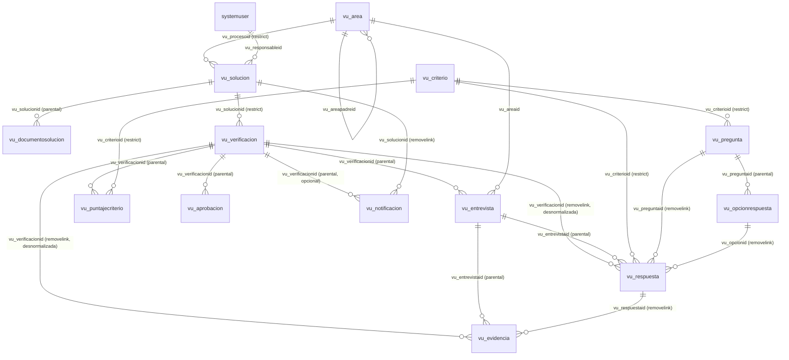
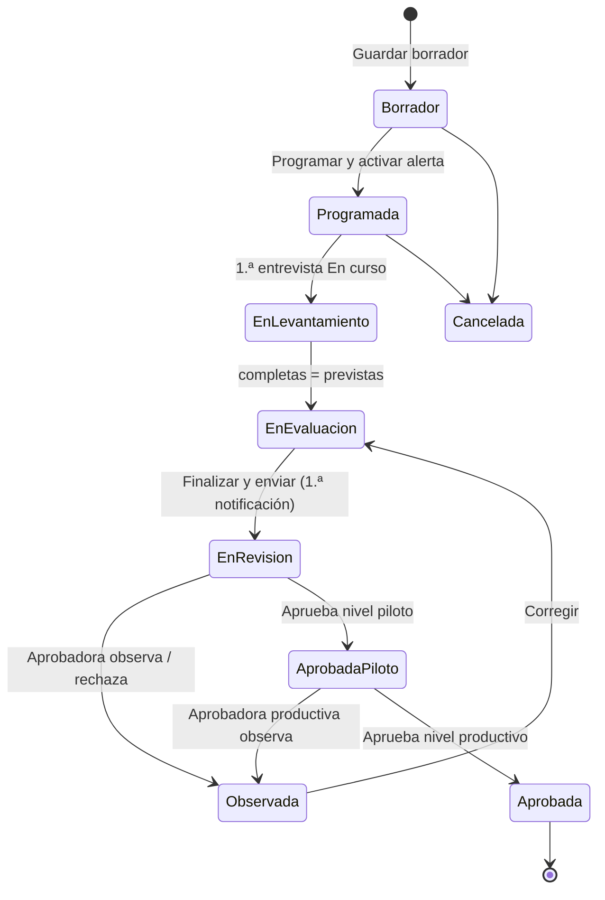
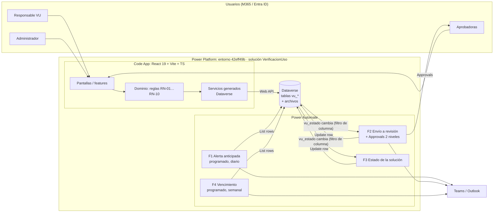

# Verificación de uso de soluciones digitales: análisis, modelo de datos y arquitectura

> Fuente: prototipo `prototipo-verificacion-uso` (copia del HTML en `docs/referencia/prototipo-original.html`).
> Plataforma objetivo: la que ya está configurada en este repo, una **Power Apps Code App** (React 19 + Vite + TS, `@microsoft/power-apps`) sobre el entorno `42eff49b-…`, con **Dataverse como base de datos** (`https://org4d363b5e.crm2.dynamics.com`).

---

## 1. Análisis del prototipo

### 1.1 Propósito
Gestionar el ciclo de **Verificación de Uso (VU)** de las soluciones digitales de la empresa (Power Apps, etc.): programar la verificación, entrevistar a los usuarios, calcular un **índice de adopción** ponderado, consolidar hallazgos y enviarlo a aprobación. Hay una regla que atraviesa todo: **mientras el levantamiento no esté completo no se notifica a nadie** (todo se guarda como borrador).

### 1.2 Pantallas y funciones

| # | Pantalla | Qué hace | Datos que maneja |
|---|----------|----------|------------------|
| 0 | **Catálogo** | Lista las soluciones con búsqueda y filtro por estado. "Ver detalle" abre un modal con la ficha y los documentos. "Programar verificación". | Solución, proceso, responsable, próxima VU, estado, descripción, n.º de usuarios objetivo, fecha de actualización, documentos (manual PDF, instructivo PDF, video de Teams, carpeta de SharePoint) |
| 1 | **Programación** | Crea la verificación de una solución y activa una alerta anticipada para el responsable (sin avisar todavía a la aprobadora). | Solución, responsable VU, fecha objetivo, anticipación del aviso (7/15/30 días), entrevistas previstas (1–20), modalidad (Teams/Presencial/Mixta), objetivo. **Fecha de alerta = fecha objetivo − anticipación** (15/08 − 15 d = 31/07) |
| 2 | **Entrevistas** | Lista de entrevistas con su avance (x de N). Cada entrevista tiene una grabación, evidencias, **preguntas definidas** (catálogo) y **preguntas surgidas en la reunión** (libres, vinculadas a un criterio y con puntaje opcional), además de oportunidades de mejora y recomendaciones. Se guarda automáticamente. | Entrevistado, área, fecha y hora, modalidad, URL de la grabación, archivos, respuestas (opción, puntaje de 1 a 10, sustento, evidencia vinculada) |
| 3 | **Evaluación** | Puntaje sugerido por criterio (calculado a partir de las respuestas) que el usuario puede ajustar dejando un sustento. Índice preliminar. | 4 criterios con peso: Frecuencia 30 %, Cobertura 25 %, Sustitución 30 %, Satisfacción 15 %. Sustento global |
| 4 | **Revisión final** | Consolidado: entrevistas completadas, índice, resultado ("Adopción parcial"), cuántas evidencias hay, oportunidades y recomendaciones. "Finalizar y enviar" solo se habilita cuando están completas todas las entrevistas previstas. | Aprobadora del piloto, aprobadora productiva posterior, notificar al finalizar |

El stepper indica 5 etapas: **Programación → Entrevistas → Evaluación → Consolidación → Aprobación**.

### 1.3 Reglas de negocio extraídas
1. **RN-01 Fecha de alerta** = `fecha_objetivo − dias_anticipacion`.
2. **RN-02 Progreso** = `entrevistas completas / entrevistas previstas`.
3. **RN-03 Índice de adopción** = `Σ(puntaje_criterio × peso) / 10` → un porcentaje de 0 a 100 (pesos que suman 100, puntajes de 1 a 10).
4. **RN-04 Puntaje sugerido por criterio** = se calcula con las respuestas de **todas** las entrevistas completas, tanto de las preguntas definidas como de las surgidas que impactan ese criterio. Propuesta: promedio simple de los puntajes no nulos.
5. **RN-05 Un ajuste manual exige sustento**: si `puntaje_final ≠ puntaje_sugerido`, el sustento es obligatorio.
6. **RN-06 Sin notificaciones parciales**: guardar un borrador o el avance nunca dispara avisos. La **primera** notificación a la aprobadora se envía al finalizar.
7. **RN-07 Finalizar** solo si `completas = previstas` (el switch de notificación y el botón se bloquean hasta entonces).
8. **RN-08 Aprobación en dos niveles**: primero la aprobadora del piloto y después la aprobadora productiva.
9. **RN-09 Resultado** (Adopción plena / parcial / baja) se deriva del índice. *Los umbrales no están en el prototipo*; propuesta: ≥ 85 plena, 60–84 parcial, < 60 baja.
10. **RN-10 Próxima VU** de la solución se recalcula al aprobar (fecha de aprobación + periodicidad de la solución).

### 1.4 Inconsistencias y vacíos del prototipo (a validar con negocio)
- **Estados de la solución**: la tabla muestra "Vigente", pero el filtro ofrece "Aprobada" y no "Vigente". Propuesta: estado **derivado** (ver §2.5) con los valores Pendiente / Programada / En proceso / En revisión / Vigente.
- **El índice no cuadra**: el HTML dice 74 %, pero con 8, 6, 7 y 8 la fórmula da **72 %** (el JS lo recalcula al cargar). Hay que confirmar la fórmula y si existe algún redondeo o factor adicional.
- **Las entrevistas previstas están fijas en 4** en el JS; en el modelo es un campo de la verificación.
- **La relación entre opción y puntaje no está definida** ("Diariamente" → 9 aparece como "puntaje sugerido" editable). Propuesta: cada opción tiene un puntaje por defecto y el entrevistador lo puede sobrescribir.
- **Periodicidad de la VU**: no aparece en el prototipo, pero la "Próxima VU" la requiere.
- No hay pantalla para **administrar el catálogo** (soluciones, documentos, preguntas, pesos). Hace falta al menos una vista de administración.
- No se indica qué hace la aprobadora (aprobar / observar / rechazar) ni qué ocurre si observa el consolidado.

---

## 2. Modelo de base de datos (Dataverse)

**Entorno**: `42eff49b-d50d-e366-9c13-fa86677af7e3` (Developer) · **URL**: `https://org4d363b5e.crm2.dynamics.com`
**Publicador**: `VerificacionUso` (nombre visible "Verificación de uso"), con prefijo **`vu`** y prefijo de valores de opción **10000**, así que las opciones van de 100000000 en adelante.
**Solución**: `VerificacionUso`, no administrada en desarrollo. Contiene todas las tablas, opciones, roles, la Code App y los flujos.
**Archivos**: columna de tipo **Archivo** en `vu_evidencia` (todo vive en Dataverse, con la misma seguridad por roles).

### 2.1 Convenciones
- Los nombres lógicos van en minúsculas, con el prefijo `vu_` y sin tildes; los nombres visibles van en español. **Este documento es el contrato**: los scripts, los flujos y el frontend usan exactamente estos nombres lógicos.
- Las búsquedas terminan en `id` (por ejemplo, `vu_solucionid`). En la Web API se leen como `_vu_solucionid_value` y se escriben como `"vu_SolucionId@odata.bind": "/vu_solucions(<guid>)"`. El nombre de la propiedad de navegación es el *SchemaName* de la búsqueda.
- Columna principal (nombre) de cada tabla: `vu_name`.
- **Activo/Inactivo** de los catálogos: con el `statecode` nativo (0 = activo), sin columna propia.
- **Propiedad**: los catálogos pertenecen a la **organización**; las tablas transaccionales pertenecen a **usuario o equipo**, porque la seguridad es por propietario.
- **Relaciones**: *Parental* (cascada total: borrar, asignar y compartir) hacia las tablas hijas; *Restrict* para eliminar en los catálogos; *RemoveLink* en las referencias opcionales.
- La **auditoría** queda activa en `vu_verificacion`, `vu_puntajecriterio` y `vu_aprobacion`.

### 2.2 Diagrama entidad-relación



### 2.3 Diccionario de tablas
Leyenda de **Req.**: **Sí** = obligatorio para la empresa (*ApplicationRequired*) · No = opcional.

#### Catálogos (propiedad de la organización)

**`vu_area`**: Área (colección: Áreas)
| Columna lógica | Tipo | Req. | Notas |
|---|---|---|---|
| vu_name | Texto (100) | Sí | Operaciones, Producción, Despacho… |
| vu_tipoarea | Opción local: Proceso (100000000) / Área (100000001) | Sí | |
| vu_areapadreid | Búsqueda → vu_area (RemoveLink) | No | Despacho → Operaciones |

**`vu_solucion`**: Solución digital
| Columna lógica | Tipo | Req. | Notas |
|---|---|---|---|
| vu_name | Texto (200) | Sí | |
| vu_descripcion | Texto multilínea (2000) | No | |
| vu_tiposolucion | Opción local: Power App 100000000 / Flujo 100000001 / Reporte 100000002 / Otro 100000003 | No | |
| vu_procesoid | Búsqueda → vu_area (Restrict) | Sí | |
| vu_responsableid | Búsqueda → systemuser (RemoveLink) | No | El catálogo importado llega sin responsable; la app lo muestra como "Sin responsable" |
| vu_usuariosobjetivo | Entero | No | |
| vu_fechaactualizacion | Fecha (solo fecha, *DateOnly*) | No | |
| vu_periodicidadmeses | Entero 1–36 (predeterminado 6) | Sí | |
| vu_proximavu | Fecha (solo fecha) | No | RN-10 |
| vu_estadovu | Opción global `vu_estadovu` | Sí | Lo escribe F3 (§2.5) |
| vu_ultimaverificacionid | Búsqueda → vu_verificacion (RemoveLink) | No | |
| vu_tipoproceso | Opción local: Estratégico 100000000 / Operativo 100000001 / Soporte 100000002 | No | Datos del catálogo importado (lista SharePoint "Apps") desde aquí hasta el final de la tabla |
| vu_proveedor | Texto (100) | No | |
| vu_tipodiseno | Opción local: Lienzo 100000000 / Model Driven 100000001 / Otro 100000002 | No | |
| vu_basedatos | Opción local: SharePoint 100000000 / Dataverse 100000001 / Otro 100000002 | No | |
| vu_tienedashboard | Sí/No (predeterminado No) | No | |
| vu_estadodesarrollo | Opción local: En proceso 100000000 / Entregado 100000001 / En uso 100000002 | No | |
| vu_evolucion | Opción local: En proceso 100000000 / Implementado 100000001 | No | |
| vu_beneficioanualpen | Decimal 0–100 000 000 000 (2) | No | Beneficio anual en soles |
| vu_capexpen | Decimal 0–100 000 000 000 (2) | No | CAPEX en soles |
| vu_capexusd | Decimal 0–100 000 000 000 (2) | No | CAPEX en dólares |
| vu_fechaimplementacion | Fecha (solo fecha) | No | |
| vu_resultadovu | Opción local: En uso 100000000 / Uso parcial 100000001 / No confirmada 100000002 | No | Resultado VU **declarado** en la lista; no es el resultado RN-09 de una verificación |

**`vu_documentosolucion`**: Documento de la solución
| Columna lógica | Tipo | Req. | Notas |
|---|---|---|---|
| vu_name | Texto (200) | Sí | "Manual de usuario" |
| vu_solucionid | Búsqueda → vu_solucion (**Parental**) | Sí | |
| vu_tipodocumento | Opción local: Manual 100000000 / Instructivo 100000001 / Video 100000002 / Carpeta 100000003 / Otro 100000004 | Sí | |
| vu_formato | Texto (50) | No | |
| vu_enlace | URL (texto en formato URL) | Sí | |
| vu_version | Texto (50) | No | |
| vu_vigente | Sí/No (predeterminado Sí) | Sí | |

**`vu_criterio`**: Criterio de evaluación
| Columna lógica | Tipo | Req. | Notas |
|---|---|---|---|
| vu_name | Texto (100) | Sí | Frecuencia, Cobertura, Sustitución, Satisfacción |
| vu_peso | Decimal 0–100 (2) | Sí | La suma de los activos debe dar 100 |
| vu_orden | Entero | Sí | |

**`vu_pregunta`**: Pregunta
| Columna lógica | Tipo | Req. | Notas |
|---|---|---|---|
| vu_name | Texto (500) | Sí | Texto de la pregunta |
| vu_criterioid | Búsqueda → vu_criterio (Restrict) | Sí | |
| vu_tiporespuesta | Opción local: Selección 100000000 / Texto 100000001 / Numérica 100000002 | Sí | |
| vu_orden | Entero | Sí | |
| vu_obligatoria | Sí/No (predeterminado Sí) | Sí | No = puede no aplicar ("si corresponde"): la respuesta queda sin puntaje, no impide completar la entrevista y no cuenta en el promedio del criterio (RN-04) |

**`vu_opcionrespuesta`**: Opción de respuesta
| Columna lógica | Tipo | Req. | Notas |
|---|---|---|---|
| vu_name | Texto (200) | Sí | "Diariamente" |
| vu_preguntaid | Búsqueda → vu_pregunta (**Parental**) | Sí | |
| vu_puntajesugerido | Entero 1–10 | Sí | |
| vu_orden | Entero | Sí | |

#### Transaccionales (propiedad de usuario o equipo)

**`vu_verificacion`**: Verificación de uso
| Columna lógica | Tipo | Req. | Notas |
|---|---|---|---|
| vu_name | Texto (20), **autonumeración `VU-{SEQNUM:5}`** | Sí | Lo genera Dataverse |
| vu_solucionid | Búsqueda → vu_solucion (Restrict) | Sí | |
| vu_responsableid | Búsqueda → systemuser | Sí | |
| vu_fechaobjetivo | Fecha (solo fecha) | Sí | |
| vu_diasanticipacion | Entero 7–30 | Sí | La UI ofrece 7, 15 o 30 |
| vu_fechaalerta | Fecha (solo fecha) | Sí | RN-01, la escribe la app |
| vu_alertaenviada | Sí/No (predeterminado No) | Sí | |
| vu_entrevistasprevistas | Entero 1–20 | Sí | |
| vu_entrevistascompletas | Entero (predeterminado 0) | Sí | La recuenta la app (RN-02 / RN-07) |
| vu_modalidad | Opción global `vu_modalidad` | Sí | |
| vu_objetivo | Texto multilínea (2000) | No | |
| vu_estado | Opción global `vu_estadoverificacion` (predeterminado Borrador) | Sí | §2.4 |
| vu_indiceadopcion | Decimal 0–100 (1) | No | RN-03 |
| vu_resultado | Opción local: Adopción plena 100000000 / Adopción parcial 100000001 / Adopción baja 100000002 | No | RN-09 |
| vu_sustentoglobal | Texto multilínea (4000) | No | |
| vu_oportunidadesconsolidadas | Texto multilínea (4000) | No | |
| vu_recomendacionesconsolidadas | Texto multilínea (4000) | No | |
| vu_aprobadorpilotoid | Búsqueda → systemuser | No (se valida al finalizar) | |
| vu_aprobadorproductivoid | Búsqueda → systemuser | No | |
| vu_notificaralfinalizar | Sí/No (predeterminado No) | Sí | |
| vu_fechaenvio | Fecha y hora | No | La escribe la app al finalizar |
| vu_fechaaprobacion | Fecha y hora | No | La escribe F2 |

**`vu_entrevista`**: Entrevista
| Columna lógica | Tipo | Req. | Notas |
|---|---|---|---|
| vu_name | Texto (200) | Sí | "Entrevista 3 – Lucía Campos" |
| vu_verificacionid | Búsqueda → vu_verificacion (**Parental**) | Sí | |
| vu_numero | Entero | Sí | |
| vu_entrevistadoid | Búsqueda → systemuser | No | Si el entrevistado es un usuario del entorno |
| vu_entrevistadonombre | Texto (200) | Sí | |
| vu_entrevistadocorreo | Texto (formato correo, 100) | No | |
| vu_areaid | Búsqueda → vu_area (RemoveLink) | No | |
| vu_fechahora | Fecha y hora | No | |
| vu_modalidad | Opción global `vu_modalidad` | No | |
| vu_estadoentrevista | Opción local: Pendiente 100000000 / En curso 100000001 / Completa 100000002 | Sí | |
| vu_urlgrabacion | URL | No | Grabación de Teams (enlace) |
| vu_oportunidadesmejora | Texto multilínea (4000) | No | |
| vu_recomendaciones | Texto multilínea (4000) | No | |
| vu_fechacompletada | Fecha y hora | No | |

**`vu_respuesta`**: Respuesta
| Columna lógica | Tipo | Req. | Notas |
|---|---|---|---|
| vu_name | Texto (500) | Sí | Copia del texto de la pregunta |
| vu_entrevistaid | Búsqueda → vu_entrevista (**Parental**) | Sí | |
| vu_verificacionid | Búsqueda → vu_verificacion (RemoveLink) | Sí | Desnormalizada: RN-04 consulta por verificación |
| vu_origen | Opción local: Definida 100000000 / Surgida en reunión 100000001 | Sí | |
| vu_preguntaid | Búsqueda → vu_pregunta (RemoveLink) | No | Solo en las definidas |
| vu_criterioid | Búsqueda → vu_criterio (Restrict) | Sí | |
| vu_opcionid | Búsqueda → vu_opcionrespuesta (RemoveLink) | No | |
| vu_respuestatexto | Texto multilínea (4000) | No | |
| vu_puntaje | Entero 1–10 | No | Obligatorio en las definidas (lo valida la app) |
| vu_sustento | Texto multilínea (4000) | No | |
| vu_orden | Entero | Sí | |

**`vu_evidencia`**: Evidencia
| Columna lógica | Tipo | Req. | Notas |
|---|---|---|---|
| vu_name | Texto (200) | Sí | Nombre del archivo |
| vu_entrevistaid | Búsqueda → vu_entrevista (**Parental**) | Sí | |
| vu_verificacionid | Búsqueda → vu_verificacion (RemoveLink) | Sí | Desnormalizada, para contar las capturas de una verificación |
| vu_respuestaid | Búsqueda → vu_respuesta (RemoveLink) | No | Evidencia vinculada a una respuesta |
| vu_tipoevidencia | Opción local: Captura 100000000 / Documento 100000001 | Sí | |
| vu_archivo | **Archivo** (máximo 32 MB) | Sí | Se sube con la API de columnas de archivo |

**`vu_puntajecriterio`**: Puntaje por criterio
| Columna lógica | Tipo | Req. | Notas |
|---|---|---|---|
| vu_name | Texto (100) | Sí | Copia del nombre del criterio |
| vu_verificacionid | Búsqueda → vu_verificacion (**Parental**) | Sí | **Clave alternativa** `vu_ak_verificacion_criterio` (vu_verificacionid, vu_criterioid) |
| vu_criterioid | Búsqueda → vu_criterio (Restrict) | Sí | |
| vu_peso | Decimal (2) | Sí | Copia del peso al crear la verificación |
| vu_puntajesugerido | Decimal 1–10 (1) | No | RN-04 |
| vu_puntajefinal | Decimal 1–10 (1) | Sí | |
| vu_sustentoajuste | Texto multilínea (4000) | No | Obligatorio si es distinto del sugerido (RN-05) |

**`vu_aprobacion`**: Aprobación
| Columna lógica | Tipo | Req. | Notas |
|---|---|---|---|
| vu_name | Texto (100) | Sí | "VU-00012 · Piloto" |
| vu_verificacionid | Búsqueda → vu_verificacion (**Parental**) | Sí | |
| vu_nivel | Opción local: Piloto 100000000 / Productiva 100000001 | Sí | |
| vu_aprobadorid | Búsqueda → systemuser | Sí | |
| vu_decision | Opción local: Pendiente 100000000 / Aprobada 100000001 / Observada 100000002 / Rechazada 100000003 | Sí | |
| vu_comentario | Texto multilínea (4000) | No | |
| vu_fechasolicitud | Fecha y hora | Sí | |
| vu_fechadecision | Fecha y hora | No | |
| vu_approvalid | Texto (100) | No | ID de Approvals |

**`vu_notificacion`**: Notificación (bitácora de RN-06)
| Columna lógica | Tipo | Req. | Notas |
|---|---|---|---|
| vu_name | Texto (300) | Sí | Asunto |
| vu_verificacionid | Búsqueda → vu_verificacion (**Parental**) | No | Vacía en los recordatorios de F4 sin verificación |
| vu_solucionid | Búsqueda → vu_solucion (RemoveLink) | No | Se llena en los recordatorios de F4 |
| vu_tiponotificacion | Opción local: Alerta anticipada 100000000 / Envío a revisión 100000001 / Decisión 100000002 / Recordatorio de vencimiento 100000003 | Sí | |
| vu_destinatarioid | Búsqueda → systemuser | Sí | |
| vu_canal | Opción local: Correo 100000000 / Teams 100000001 | Sí | |
| vu_fechaenvio | Fecha y hora | Sí | |
| vu_estadoenvio | Opción local: Enviada 100000000 / Error 100000001 | Sí | |

#### Opciones globales
| Nombre lógico | Valores |
|---|---|
| `vu_modalidad` | Teams 100000000 · Presencial 100000001 · Mixta 100000002 |
| `vu_estadoverificacion` | Borrador 100000000 · Programada 100000001 · En levantamiento 100000002 · En evaluación 100000003 · En revisión 100000004 · Observada 100000005 · Aprobada piloto 100000006 · Aprobada 100000007 · Cancelada 100000008 |
| `vu_estadovu` | Pendiente 100000000 · Programada 100000001 · En proceso 100000002 · En revisión 100000003 · Vigente 100000004 |

### 2.4 Estados de `vu_verificacion.vu_estado`


La app solo puede cambiar el estado hasta *En revisión*. Los estados posteriores los escribe el flujo F2.

### 2.5 Estado derivado de la solución (`vu_solucion.vu_estadovu`)
| Situación de la última verificación | vu_estadovu |
|---|---|
| No existe, Borrador, Cancelada, o `vu_proximavu` < hoy | **Pendiente** |
| Programada | **Programada** |
| En levantamiento / En evaluación / Observada | **En proceso** |
| En revisión / Aprobada piloto | **En revisión** |
| Aprobada y `vu_proximavu` ≥ hoy | **Vigente** |

### 2.6 Datos semilla
- vu_criterio: Frecuencia 30, Cobertura 25, Sustitución 30, Satisfacción 15.
- vu_pregunta: las 11 preguntas de la hoja "Criterios (validar)" del Excel de verificaciones, de tipo Numérica (puntaje 1–10): 3 de Frecuencia, 3 de Cobertura, 3 de Sustitución y 2 de Satisfacción. Dos no son obligatorias: "El sistema es utilizado por más de un área (si corresponde)" y "La solución ha sido integrada con aplicaciones o sistemas existentes (de ser aplicable)". Detalle en `infra/dataverse/seed/criterios.json`.
- vu_area: las áreas del prototipo.
- vu_solucion: no hay datos de ejemplo; el catálogo real se importa desde la lista SharePoint "Apps" (`infra/dataverse/importar-apps.mjs`).

---

## 3. Arquitectura

### 3.1 Vista general



### 3.2 Componentes

| Capa | Tecnología | Responsabilidad |
|---|---|---|
| **Frontend** | Power Apps Code App, React 19, TypeScript, **Fluent UI v9**, React Router (modo hash), TanStack Query | Las 5 pantallas + la administración. Validaciones y cálculos en vivo |
| **Acceso a datos** | Fuentes de datos de **Dataverse** agregadas a la Code App, con modelos y servicios TS generados en `src/generated/` | CRUD con tipos, `$filter`/`$select`/`$expand`, subida y descarga de las columnas de archivo |
| **Datos** | Dataverse (solución `VerificacionUso`) | Persistencia, relaciones con cascada, autonumeración, claves alternativas, auditoría, seguridad por roles |
| **Procesos** | Power Automate con el conector **Microsoft Dataverse**, en la misma solución | Notificaciones, aprobaciones y estados derivados |
| **Notificaciones** | Outlook + Teams; Approvals | Solo en los hitos (RN-06), registradas en `vu_notificacion` |

### 3.3 Flujos de Power Automate (conector Dataverse)

| Flujo | Disparador | Lógica |
|---|---|---|
| **F1 Alerta anticipada** | Programado, diario a las 07:00 (Lima) | *List rows* `vu_verificacions` con el filtro `vu_estado eq 100000001 and vu_fechaalerta le <hoy> and vu_alertaenviada eq false` → correo al **responsable** → `vu_alertaenviada = true` + `vu_notificacion` |
| **F2 Envío a revisión** | *When a row is added, modified or deleted* (Modified) en `vu_verificacion`, con **columnas de filtro `vu_estado`** y **filtro de filas `vu_estado eq 100000004`** | Revalida RN-07 (cuenta las `vu_entrevista` con `vu_estadoentrevista eq 100000002`) → crea `vu_aprobacion` (Piloto) → Approvals (Aprobar/Observar/Rechazar) → nivel Productivo → `vu_estado = Aprobada`, `vu_fechaaprobacion` y `vu_solucion.vu_proximavu = hoy + vu_periodicidadmeses`. Observada o Rechazada → `vu_estado = Observada` + aviso |
| **F3 Estado de la solución** | *When a row is added, modified or deleted* (Added, Modified) en `vu_verificacion`, con **columnas de filtro `vu_estado`** | Recalcula `vu_estadovu` y `vu_ultimaverificacionid` de la solución según §2.5. También se dispara con los cambios de estado que hace F2, porque el filtro es por columna y no hay riesgo de bucle: F3 solo escribe en `vu_solucion` |
| **F4 Vencimiento** | Programado, semanal | Soluciones con `vu_proximavu` dentro de 30 días y sin una verificación activa → recordatorio + `vu_notificacion` (con `vu_solucionid`) |

> **RN-06 por diseño**: ningún flujo escucha `vu_entrevista`, `vu_respuesta`, `vu_puntajecriterio` ni `vu_evidencia`. Además, como el disparador filtra por la columna `vu_estado`, editar otros campos de la verificación no dispara nada.

### 3.4 Operaciones de varios pasos en la app
| Acción del usuario | Pasos | Cómo se protege |
|---|---|---|
| Programar verificación | 1) crear `vu_verificacion` (el código lo pone la autonumeración) 2) crear 4 filas de `vu_puntajecriterio` con los pesos copiados | La clave alternativa (verificación, criterio) impide duplicados; el paso 2 se reintenta al abrir la verificación si faltan filas |
| Completar entrevista | 1) `vu_estadoentrevista = Completa` 2) recontar y escribir `vu_entrevistascompletas` | Siempre se **recuenta** |
| Abrir Evaluación | Recalcula `vu_puntajesugerido` a partir de `vu_respuesta` filtrando por `_vu_verificacionid_value` | Valor derivado |
| Finalizar y enviar | Guarda el consolidado y el índice y pone `vu_estado = En revisión` (esto dispara F2) | F2 revalida RN-07 |

### 3.5 Estructura del código (`src/`)

```
src/
├─ app/                 # Router, providers, layout + stepper
├─ features/            # catalogo, programacion, entrevistas, evaluacion, revision, admin
├─ domain/              # Reglas puras (fechas, evaluacion, flujo, codigo, consolidacion) + pruebas
├─ data/
│  ├─ repositorios.ts   # Interfaces por agregado (tipos de dominio)
│  ├─ servicios.ts      # Operaciones de varios pasos
│  ├─ mock/             # En memoria (desarrollo sin conexión y pruebas)
│  └─ dataverse/        # Mapeadores y repositorios sobre los servicios generados
├─ generated/           # Salida de "add data source" de Dataverse (no editar)
└─ components/
```
`VITE_DATA_SOURCE=dataverse|mock` (por defecto **dataverse**).

### 3.6 Seguridad (roles de Dataverse, en la solución)

| Rol | Catálogos (área, solución, documento, criterio, pregunta, opción) | vu_verificacion y sus hijas (entrevista, respuesta, evidencia, puntaje) | vu_aprobacion / vu_notificacion | Administración |
|---|---|---|---|---|
| **VU Lector** | Leer (organización) | – | – | – |
| **VU Responsable** | Leer (organización) | Crear, leer, escribir y anexar: **usuario**; leer: unidad de negocio | Leer: usuario | – |
| **VU Aprobador** | Leer (organización) | Leer (organización) | Leer y escribir (organización) | – |
| **VU Administrador** | CRUD (organización) | CRUD (organización) | CRUD (organización) | Mantiene los catálogos y los pesos |

Las tablas hijas heredan el propietario de su verificación por la relación *Parental* (al asignar se propaga). Los flujos usan una conexión de cuenta de servicio con un rol de administrador del sistema o "VU Administrador". Los entrevistados **no necesitan acceso**.

### 3.7 ALM
- Todo va en la solución `VerificacionUso` (publicador `vu`): tablas, opciones, roles, flujos, la Code App, referencias de conexión (Dataverse, Approvals, Outlook, Teams) y la variable de entorno `vu_CuentaServicioEmail`.
- Las tablas se crean con `infra/dataverse/`, un script Node idempotente que usa la Web API y un token de `az`. El script está pensado para ejecutarse una vez en desarrollo; los entornos de Test y Prod reciben la **solución exportada como administrada**.
- La Code App se publica con `pa`/`pac code push`. Las pruebas unitarias de `src/domain/` van con Vitest.

---

## 4. Supuestos y preguntas abiertas
1. Fórmula exacta del índice y umbrales de resultado (74 % frente a 72 %; plena/parcial/baja).
2. Puntaje por defecto de cada opción de respuesta y la regla de agregación del puntaje sugerido.
3. Periodicidad estándar de la VU.
4. ¿La aprobación productiva ocurre inmediatamente después de la del piloto o en otro momento? Si no hay aprobadora productiva, hoy la verificación se queda en "Aprobada piloto".
5. ¿Qué pasa si una entrevista prevista no se puede realizar?
6. Significado del switch "Notificar al finalizar" (hoy no tiene efecto).
7. ¿Hace falta un estado "Rechazada" propio? Hoy un rechazo deja la verificación en "Observada".
8. ¿Existe una cuenta de servicio con licencia para las conexiones de los flujos?
