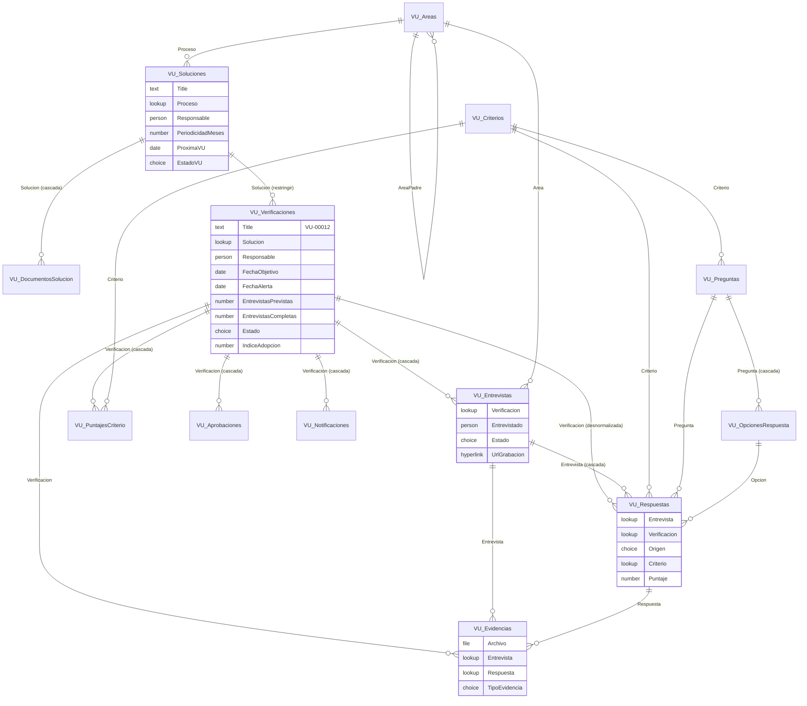
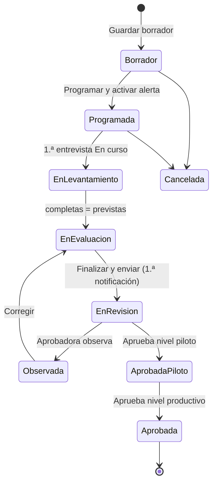
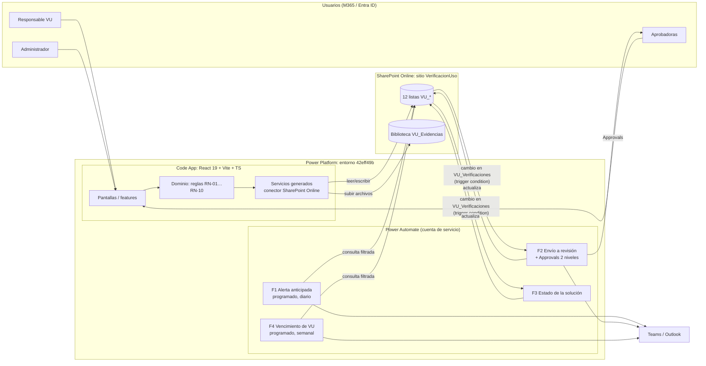

# Verificación de uso de soluciones digitales: análisis, modelo de datos y arquitectura

> Fuente: prototipo `prototipo-verificacion-uso` (copia del HTML en `docs/referencia/prototipo-original.html`).
> Plataforma objetivo: la que ya está configurada en este repo, una **Power Apps Code App** (React 19 + Vite + TS, `@microsoft/power-apps`) sobre el entorno `42eff49b-…`, con **SharePoint Online como base de datos** (listas y bibliotecas en `biomont.sharepoint.com`).

---

## 1. Análisis del prototipo

### 1.1 Propósito
Gestionar el ciclo de **Verificación de Uso (VU)** de las soluciones digitales de la empresa (Power Apps, etc.): programar la verificación, entrevistar a los usuarios, calcular un **índice de adopción** ponderado, consolidar hallazgos y enviarlo a aprobación. Hay una regla que atraviesa todo: **mientras el levantamiento no esté completo no se notifica a nadie** (todo se guarda como borrador).

### 1.2 Pantallas y funciones

| # | Pantalla | Qué hace | Datos que maneja |
|---|----------|----------|------------------|
| 0 | **Catálogo** | Lista las soluciones con búsqueda y filtro por estado. "Ver detalle" abre un modal con la ficha y los documentos. "Programar verificación". | Solución, proceso, responsable, próxima VU, estado, descripción, n.º de usuarios objetivo, fecha de actualización, documentos (manual PDF, instructivo PDF, video de Teams, carpeta de SharePoint) |
| 1 | **Programación** | Crea la verificación de una solución y activa una alerta anticipada para el responsable (sin avisar todavía a la aprobadora). | Solución, responsable VU, fecha objetivo, anticipación del aviso (7/15/30 días), entrevistas previstas (1–20), modalidad (Teams/Presencial/Mixta), objetivo. **Fecha de alerta = fecha objetivo − anticipación** (15/08 − 15 d = 31/07) |
| 2 | **Entrevistas** | Lista de entrevistas con su avance (x de N). Cada entrevista tiene una grabación, evidencias, **preguntas definidas** (catálogo) y **preguntas surgidas en la reunión** (libres, vinculadas a un criterio y con puntaje opcional), además de oportunidades de mejora y recomendaciones. Se guarda automáticamente. | Entrevistado, área, fecha y hora, modalidad, URL de la grabación, archivos, respuestas (opción, puntaje de 1 a 10, sustento, evidencia vinculada) |
| 3 | **Evaluación** | Puntaje sugerido por criterio (calculado a partir de las respuestas) que el usuario puede ajustar dejando un sustento. Índice preliminar. | 4 criterios con peso: Frecuencia 30 %, Cobertura 25 %, Sustitución 30 %, Satisfacción 15 %. Sustento global |
| 4 | **Revisión final** | Consolidado: entrevistas completadas, índice, resultado ("Adopción parcial"), cuántas evidencias hay, oportunidades y recomendaciones. "Finalizar y enviar" solo se habilita cuando están completas todas las entrevistas previstas. | Aprobadora del piloto, aprobadora productiva posterior, notificar al finalizar |

El stepper indica 5 etapas: **Programación → Entrevistas → Evaluación → Consolidación → Aprobación**.

### 1.3 Reglas de negocio extraídas
1. **RN-01 Fecha de alerta** = `fecha_objetivo − dias_anticipacion`.
2. **RN-02 Progreso** = `entrevistas completas / entrevistas previstas`.
3. **RN-03 Índice de adopción** = `Σ(puntaje_criterio × peso) / 10` → un porcentaje de 0 a 100 (pesos que suman 100, puntajes de 1 a 10).
4. **RN-04 Puntaje sugerido por criterio** = se calcula con las respuestas de **todas** las entrevistas completas, tanto de las preguntas definidas como de las surgidas que impactan ese criterio. Propuesta: promedio simple de los puntajes no nulos.
5. **RN-05 Un ajuste manual exige sustento**: si `puntaje_final ≠ puntaje_sugerido`, el sustento es obligatorio.
6. **RN-06 Sin notificaciones parciales**: guardar un borrador o el avance nunca dispara avisos. La **primera** notificación a la aprobadora se envía al finalizar.
7. **RN-07 Finalizar** solo si `completas = previstas` (el switch de notificación y el botón se bloquean hasta entonces).
8. **RN-08 Aprobación en dos niveles**: primero la aprobadora del piloto y después la aprobadora productiva.
9. **RN-09 Resultado** (Adopción plena / parcial / baja) se deriva del índice. *Los umbrales no están en el prototipo*; propuesta: ≥ 85 plena, 60–84 parcial, < 60 baja.
10. **RN-10 Próxima VU** de la solución se recalcula al aprobar (fecha de aprobación + periodicidad de la solución).

### 1.4 Inconsistencias y vacíos del prototipo (a validar con negocio)
- **Estados de la solución**: la tabla muestra "Vigente", pero el filtro ofrece "Aprobada" y no "Vigente". Propuesta: estado **derivado** (ver §2.5) con los valores Pendiente / Programada / En proceso / En revisión / Vigente.
- **El índice no cuadra**: el HTML dice 74 %, pero con 8, 6, 7 y 8 la fórmula da **72 %** (el JS lo recalcula al cargar). Hay que confirmar la fórmula y si existe algún redondeo o factor adicional.
- **Las entrevistas previstas están fijas en 4** en el JS; en el modelo es un campo de la verificación.
- **La relación entre opción y puntaje no está definida** ("Diariamente" → 9 aparece como "puntaje sugerido" editable). Propuesta: cada opción tiene un puntaje por defecto y el entrevistador lo puede sobrescribir.
- **Periodicidad de la VU**: no aparece en el prototipo, pero la "Próxima VU" la requiere.
- No hay pantalla para **administrar el catálogo** (soluciones, documentos, preguntas, pesos). Hace falta al menos una vista de administración.
- No se indica qué hace la aprobadora (aprobar / observar / rechazar) ni qué ocurre si observa el consolidado.

---

## 2. Modelo de base de datos (SharePoint Online)

**Sitio**: `https://biomont.sharepoint.com/sites/VerificacionUso` (nombre supuesto). Es un sitio dedicado para poder controlar los permisos sin afectar otros contenidos.
**Contenido**: 12 listas y 1 biblioteca de documentos. Los nombres internos de las columnas van **sin tildes ni espacios** (se crean así y después se cambia el nombre visible), porque los servicios TS generados y las expresiones de Power Automate usan el nombre interno.

### 2.1 Restricciones de SharePoint que condicionan el diseño
| Restricción | Decisión de diseño |
|---|---|
| Umbral de vista de **5 000 elementos** | **Indexar** toda columna que se use en un `$filter` (marcadas con 🔎). Una lista admite hasta 20 índices |
| **Máximo 12 columnas de búsqueda o persona** por consulta | Ninguna lista pasa de 6. Las consultas piden solo las columnas que necesitan (`$select`) |
| Sin relaciones obligatorias ni cascada por defecto | Las columnas de búsqueda usan *Exigir comportamiento de relación*: **Eliminación en cascada** en las listas hijas y **Restringir eliminación** en los catálogos |
| Sin autonumeración | `Title` de la verificación = `VU-` + ID con 5 dígitos, que escribe la app justo después de crear el elemento |
| Sin columnas acumulativas (*rollup*) ni transacciones | Los contadores (`EntrevistasCompletas`, índice, puntajes sugeridos) los calcula la app y se guardan desnormalizados. Lo que se crea en varios pasos es **idempotente** (se crea si falta) |
| Las columnas calculadas no se pueden filtrar desde el conector | `FechaAlerta` es una fecha normal que escribe la app (no una columna calculada), porque el flujo de alertas la filtra |
| Texto de una línea: máximo 255 caracteres | Los textos largos van en columnas multilínea de **texto sin formato** |
| La auditoría es limitada | Se activa el **historial de versiones** en Verificaciones, PuntajesCriterio y Aprobaciones para saber quién cambió cada puntaje y cuándo |

### 2.2 Diagrama de listas y relaciones (columnas de búsqueda)



### 2.3 Diccionario de listas
Leyenda: 🔎 = columna indexada · **Req.** = obligatoria en SharePoint · todas las listas tienen además `ID`, `Created`, `Author`, `Modified` y `Editor`, que son nativas.

#### Catálogos y configuración (los mantiene el administrador)

**`VU_Areas`**: procesos y áreas
| Columna (interna) | Tipo SP | Req. | Notas |
|---|---|---|---|
| Title | Una línea | Sí | Operaciones, Producción, Despacho, Logística… |
| TipoArea | Elección: Proceso / Área | Sí | |
| AreaPadre | Búsqueda → VU_Areas | No | Despacho → Operaciones |
| Activo | Sí/No | Sí | |

**`VU_Soluciones`**
| Columna | Tipo SP | Req. | Notas |
|---|---|---|---|
| Title | Una línea | Sí | Nombre de la solución |
| Descripcion | Varias líneas (texto sin formato) | No | |
| TipoSolucion | Elección: Power App / Flujo / Reporte / Otro | No | |
| Proceso | Búsqueda → VU_Areas (restringir) | Sí | |
| Responsable 🔎 | Persona | Sí | |
| UsuariosObjetivo | Número | No | |
| FechaActualizacion | Fecha | No | |
| PeriodicidadMeses | Número (predeterminado 6) | Sí | |
| ProximaVU 🔎 | Fecha | No | RN-10 |
| EstadoVU 🔎 | Elección: Pendiente / Programada / En proceso / En revisión / Vigente | Sí | Lo escribe el flujo F3 (§2.5) |
| UltimaVerificacionId | Número | No | ID de VU_Verificaciones (sin búsqueda, para evitar una referencia circular) |

**`VU_DocumentosSolucion`**: material del modal "Ver detalle"
| Columna | Tipo SP | Req. | Notas |
|---|---|---|---|
| Title | Una línea | Sí | "Manual de usuario" |
| Solucion 🔎 | Búsqueda → VU_Soluciones (cascada) | Sí | |
| TipoDocumento | Elección: Manual / Instructivo / Video / Carpeta / Otro | Sí | Define el icono |
| Formato | Una línea | No | PDF, Teams, SharePoint |
| Enlace | Hipervínculo | Sí | PDF, video de Stream/Teams o carpeta |
| Version | Una línea | No | |
| Vigente | Sí/No | Sí | |

**`VU_Criterios`**
| Columna | Tipo SP | Req. | Notas |
|---|---|---|---|
| Title | Una línea | Sí | Frecuencia, Cobertura, Sustitución, Satisfacción |
| Peso | Número (0–100) | Sí | La suma de los activos debe dar 100 (lo valida la pantalla de administración) |
| Orden | Número | Sí | |
| Activo | Sí/No | Sí | |

**`VU_Preguntas`**
| Columna | Tipo SP | Req. | Notas |
|---|---|---|---|
| Title | Una línea | Sí | Texto de la pregunta (≤ 255) |
| Criterio | Búsqueda → VU_Criterios (restringir) | Sí | |
| TipoRespuesta | Elección: Selección / Texto / Numérica | Sí | |
| Orden, Activo | Número, Sí/No | Sí | |

**`VU_OpcionesRespuesta`**
| Columna | Tipo SP | Req. | Notas |
|---|---|---|---|
| Title | Una línea | Sí | "Diariamente" |
| Pregunta 🔎 | Búsqueda → VU_Preguntas (cascada) | Sí | |
| PuntajeSugerido | Número 1–10 | Sí | Precarga el puntaje de la respuesta |
| Orden | Número | Sí | |

#### Transaccionales

**`VU_Verificaciones`**: cabecera del proceso
| Columna | Tipo SP | Req. | Notas |
|---|---|---|---|
| Title | Una línea | Sí | `VU-00012` (lo escribe la app al crear) |
| Solucion 🔎 | Búsqueda → VU_Soluciones (restringir) | Sí | |
| Responsable 🔎 | Persona | Sí | |
| FechaObjetivo | Fecha | Sí | |
| DiasAnticipacion | Número (validación: 7, 15 o 30) | Sí | |
| FechaAlerta 🔎 | Fecha | Sí | RN-01, la escribe la app |
| AlertaEnviada | Sí/No | Sí | Evita enviar la alerta dos veces |
| EntrevistasPrevistas | Número 1–20 | Sí | |
| EntrevistasCompletas | Número | Sí | Lo actualiza la app al completar una entrevista (RN-02 / RN-07) |
| Modalidad | Elección: Teams / Presencial / Mixta | Sí | |
| Objetivo | Varias líneas | No | |
| Estado 🔎 | Elección (ver §2.4) | Sí | |
| IndiceAdopcion | Número (1 decimal) | No | RN-03 |
| Resultado | Elección: Adopción plena / parcial / baja | No | RN-09 |
| SustentoGlobal | Varias líneas | No | |
| OportunidadesConsolidadas | Varias líneas | No | Una por línea |
| RecomendacionesConsolidadas | Varias líneas | No | |
| AprobadorPiloto | Persona | No (se valida al finalizar) | |
| AprobadorProductivo | Persona | No | |
| NotificarAlFinalizar | Sí/No | Sí | |
| FechaEnvio, FechaAprobacion | Fecha y hora | No | |

**`VU_Entrevistas`**
| Columna | Tipo SP | Req. | Notas |
|---|---|---|---|
| Title | Una línea | Sí | "Entrevista 3 – Lucía Campos" |
| Verificacion 🔎 | Búsqueda → VU_Verificaciones (cascada) | Sí | |
| Numero | Número | Sí | |
| Entrevistado | Persona | No | Cualquier usuario de Entra ID; **no necesita licencia de Power Apps** |
| EntrevistadoNombre | Una línea | Sí | Respaldo si es externo; la app lo llena con el nombre de la persona |
| Area | Búsqueda → VU_Areas | No | |
| FechaHora | Fecha y hora | No | |
| Modalidad | Elección: Teams / Presencial | No | |
| Estado 🔎 | Elección: Pendiente / En curso / Completa | Sí | |
| UrlGrabacion | Hipervínculo | No | La grabación de Teams ya está en SharePoint/OneDrive; solo se enlaza |
| OportunidadesMejora, Recomendaciones | Varias líneas | No | |
| FechaCompletada | Fecha y hora | No | |

**`VU_Respuestas`**: tanto las preguntas definidas como las surgidas en la reunión
| Columna | Tipo SP | Req. | Notas |
|---|---|---|---|
| Title | Una línea | Sí | Copia del texto de la pregunta (para las definidas también) |
| Entrevista 🔎 | Búsqueda → VU_Entrevistas (cascada) | Sí | |
| Verificacion 🔎 | Búsqueda → VU_Verificaciones | Sí | **Desnormalizada**: SharePoint no filtra por la búsqueda de una búsqueda, y RN-04 necesita todas las respuestas de una verificación en una sola consulta |
| Origen | Elección: Definida / Surgida en reunión | Sí | |
| Pregunta | Búsqueda → VU_Preguntas | No | Solo en las definidas |
| Criterio 🔎 | Búsqueda → VU_Criterios | Sí | "Impacta: Cobertura" |
| Opcion | Búsqueda → VU_OpcionesRespuesta | No | |
| RespuestaTexto | Varias líneas | No | |
| Puntaje | Número 1–10 | No | Obligatorio en las definidas (lo valida la app) |
| Sustento | Varias líneas | No | |
| Orden | Número | Sí | |

**`VU_PuntajesCriterio`**: una fila por criterio y verificación
| Columna | Tipo SP | Req. | Notas |
|---|---|---|---|
| Title | Una línea | Sí | Nombre del criterio (copia) |
| Verificacion 🔎 | Búsqueda → VU_Verificaciones (cascada) | Sí | La app impide duplicados de (Verificación, Criterio) |
| Criterio | Búsqueda → VU_Criterios | Sí | |
| Peso | Número | Sí | **Copia** del peso al crear la verificación (si después cambian los pesos, el histórico no se altera) |
| PuntajeSugerido | Número (1 decimal) | No | RN-04 |
| PuntajeFinal | Número (1 decimal) | Sí | |
| SustentoAjuste | Varias líneas | No | Obligatorio si es distinto del sugerido (RN-05, lo valida la app) |

**`VU_Aprobaciones`**
| Columna | Tipo SP | Req. | Notas |
|---|---|---|---|
| Title | Una línea | Sí | "VU-00012 · Piloto" |
| Verificacion 🔎 | Búsqueda → VU_Verificaciones (cascada) | Sí | |
| Nivel | Elección: Piloto / Productiva | Sí | RN-08 |
| Aprobador | Persona | Sí | |
| Decision | Elección: Pendiente / Aprobada / Observada / Rechazada | Sí | |
| Comentario | Varias líneas | No | |
| FechaSolicitud, FechaDecision | Fecha y hora | Sí / No | |
| ApprovalId | Una línea | No | ID de Power Automate Approvals |

**`VU_Notificaciones`**: bitácora que garantiza RN-06
| Columna | Tipo SP | Req. | Notas |
|---|---|---|---|
| Title | Una línea | Sí | Asunto |
| Verificacion 🔎 | Búsqueda → VU_Verificaciones (cascada) | No | Vacía en los recordatorios de F4 de soluciones que nunca tuvieron una verificación |
| TipoNotificacion | Elección: Alerta anticipada / Envío a revisión / Decisión / Recordatorio de vencimiento | Sí | |
| Destinatario | Persona | Sí | |
| Canal | Elección: Correo / Teams | Sí | |
| FechaEnvio | Fecha y hora | Sí | |
| EstadoEnvio | Elección: Enviada / Error | Sí | |

**Biblioteca `VU_Evidencias`**: capturas y documentos (sustituye a la tabla de evidencias: el archivo **es** el registro)
| Columna | Tipo SP | Req. | Notas |
|---|---|---|---|
| (Archivo) | – | – | Carpeta `/{VU-00012}/Entrevista-03/` |
| Verificacion 🔎 | Búsqueda → VU_Verificaciones | Sí | Para contar "7 capturas" con una sola consulta |
| Entrevista 🔎 | Búsqueda → VU_Entrevistas | Sí | |
| Respuesta | Búsqueda → VU_Respuestas | No | "Vincular una captura específica a esta respuesta" |
| TipoEvidencia | Elección: Captura / Documento | Sí | Las grabaciones se cuentan en `VU_Entrevistas.UrlGrabacion` |

> Las búsquedas de la biblioteca no tienen cascada (los archivos no se borran automáticamente); la eliminación de una verificación borra su carpeta mediante un flujo o la app.

### 2.4 Estados de `VU_Verificaciones.Estado`


Valores de la elección: Borrador · Programada · En levantamiento · En evaluación · En revisión · Observada · Aprobada piloto · Aprobada · Cancelada.
La app solo puede cambiar el estado hasta *En revisión*. Los estados posteriores los escribe el flujo F2.

### 2.5 Estado derivado de la solución (`VU_Soluciones.EstadoVU`)
| Situación de la última verificación | EstadoVU |
|---|---|
| No existe o `ProximaVU` < hoy | **Pendiente** |
| Programada | **Programada** |
| En levantamiento / En evaluación / Observada | **En proceso** |
| En revisión / Aprobada piloto | **En revisión** |
| Aprobada y `ProximaVU` ≥ hoy | **Vigente** |

### 2.6 Datos semilla
- VU_Criterios: Frecuencia 30, Cobertura 25, Sustitución 30, Satisfacción 15.
- VU_Preguntas y VU_OpcionesRespuesta: "¿Con qué frecuencia utiliza la solución?" con las opciones Diariamente 9, Varias veces por semana 8, Semanalmente 6, Ocasionalmente 4, No la utiliza 1 (puntajes a validar).
- VU_Areas y VU_Soluciones: las 4 soluciones y sus áreas del prototipo.

### 2.7 Volumetría
Por ejemplo, 30 soluciones × 2 VU al año × 6 entrevistas × 10 respuestas ≈ **3 600 respuestas al año**. VU_Respuestas es la única lista que pasará de 5 000 elementos (en 1 o 2 años); por eso todas sus consultas filtran por `Verificacion` o `Entrevista`, que están indexadas.

---

## 3. Arquitectura

### 3.1 Vista general



### 3.2 Componentes

| Capa | Tecnología | Responsabilidad |
|---|---|---|
| **Frontend** | Power Apps Code App (ya está el scaffold en este repo), React 19, TypeScript, **Fluent UI v9**, React Router (modo hash), TanStack Query (caché y autoguardado con *debounce*) | Las 5 pantallas + la administración del catálogo. Validaciones y cálculos (índice, fecha de alerta, progreso, puntaje sugerido) |
| **Acceso a datos** | Conector **SharePoint Online** agregado con `pac code add-data-source` (una fuente por lista) → modelos y servicios TS generados en `src/generated/`. La conexión queda en `power.config.json → connectionReferences` | CRUD con tipos y filtros OData (`$filter` sobre columnas indexadas, `$select`, `$top`). Subida de archivos a la biblioteca con la operación de creación de archivo del conector |
| **Datos** | Listas de SharePoint (§2) | Persistencia, relaciones por búsqueda con cascada o restricción, historial de versiones |
| **Procesos** | Power Automate con una **conexión de cuenta de servicio** | Notificaciones, aprobaciones y estados derivados: todo lo que no debe depender de que la app esté abierta ni de los permisos del usuario |
| **Notificaciones** | Outlook + tarjeta adaptable de Teams; Approvals | Solo en los hitos (RN-06), registradas en VU_Notificaciones |

### 3.3 Flujos de Power Automate

| Flujo | Disparador | Lógica |
|---|---|---|
| **F1 Alerta anticipada** | Programado, diario a las 07:00 | *Get items* de VU_Verificaciones con `Estado eq 'Programada' and FechaAlerta le '{hoy}' and AlertaEnviada eq 0` → avisa al **responsable** (nunca a la aprobadora) → `AlertaEnviada = Sí` y registro en VU_Notificaciones |
| **F2 Envío a revisión** | *When an item is created or modified* en VU_Verificaciones, con la **condición de desencadenador** `@equals(triggerOutputs()?['body/Estado/Value'],'En revisión')` + *Get changes for an item* (que confirma que `Estado` cambió y que no se trata de otra edición) | Revalida RN-07 en el servidor (cuenta las entrevistas completas) → crea VU_Aprobaciones (Piloto) → *Start and wait for an approval* → Aprobada: repite el patrón con el nivel Productivo → al final escribe `Estado = Aprobada`, `FechaAprobacion` y, en la solución, `ProximaVU = hoy + PeriodicidadMeses`. Observada: `Estado = Observada` y aviso al responsable |
| **F3 Estado de la solución** | *When an item is created or modified* en VU_Verificaciones, con una condición que **excluye las ediciones de la cuenta de servicio** (`Editor/Email`) para evitar bucles | Recalcula `EstadoVU` y `UltimaVerificacionId` de la solución según §2.5 |
| **F4 Vencimiento** | Programado, semanal | Soluciones con `ProximaVU` dentro de 30 días y sin una verificación activa → recordatorio al responsable de la solución; `EstadoVU = Pendiente` cuando se vence la fecha |

> **RN-06 por diseño**: no hay flujos sobre VU_Entrevistas, VU_Respuestas, VU_PuntajesCriterio ni VU_Evidencias. El autoguardado y "Guardar avance sin notificar" no pueden disparar avisos.

### 3.4 Operaciones de varios pasos en la app (sin transacciones)
| Acción del usuario | Pasos | Cómo se protege |
|---|---|---|
| Programar verificación | 1) crear la verificación 2) escribir `Title = VU-{ID}` 3) crear 4 filas de VU_PuntajesCriterio con los pesos copiados | Los pasos 2 y 3 se reintentan **al abrir la verificación** si faltan (son idempotentes) |
| Completar entrevista | 1) `Entrevista.Estado = Completa` 2) recontar las completas y escribir `Verificacion.EntrevistasCompletas` | Siempre se **recuenta** (nunca `+1`), así que un reintento no descuadra |
| Abrir Evaluación | Recalcula `PuntajeSugerido` de cada criterio a partir de VU_Respuestas (filtrando por `Verificacion`) de las entrevistas completas | Valor derivado; se puede regenerar siempre |
| Finalizar y enviar | Guarda el consolidado y el índice y pone `Estado = En revisión` (esto dispara F2) | F2 revalida RN-07 en el servidor |

Concurrencia: normalmente cada verificación la edita una sola persona; se acepta que el último en guardar sobrescriba. El autoguardado es por entrevista y por campo modificado, no del formulario completo.

### 3.5 Estructura propuesta del código (`src/`)

```
src/
├─ app/                 # Router, providers (QueryClient, FluentProvider), layout + stepper
├─ features/
│  ├─ catalogo/         # Tabla con búsqueda/filtro, modal de detalle, documentos
│  ├─ programacion/     # Formulario de la verificación + banner de fecha de alerta
│  ├─ entrevistas/      # Lista + editor (respuestas definidas y surgidas, evidencias, autoguardado)
│  ├─ evaluacion/       # Sliders por criterio, sugerido vs. final, sustento
│  ├─ revision/         # Consolidado, control del envío
│  └─ admin/            # Soluciones, documentos, criterios/pesos, preguntas/opciones
├─ domain/              # Funciones puras y testeables (sin dependencias de SharePoint)
│  ├─ fechas.ts         # calcularFechaAlerta (RN-01), calcularProximaVU (RN-10)
│  ├─ evaluacion.ts     # puntajeSugerido (RN-04), indiceAdopcion (RN-03), resultado (RN-09)
│  └─ flujo.ts          # puedeFinalizar (RN-07), transiciones válidas de estado
├─ data/                # Repositorios por lista: mapean los modelos generados (búsquedas, personas, elecciones) a tipos de dominio
├─ generated/           # Salida de pac code add-data-source (no editar)
└─ components/          # UI compartida (Badge de estado, Progress, DocItem, ScoreSlider)
```
La capa `data/` **aísla los detalles de SharePoint**: las búsquedas como `{Id, Value}`, las personas como `{Claims, Email}` y los nombres internos de las columnas. Si algún día se migra a Dataverse, solo se reescribe esa capa.

### 3.6 Seguridad
SharePoint no tiene roles por registro como Dataverse, así que la seguridad se reparte en tres niveles:

1. **Permisos del sitio con grupos de SharePoint** (heredados por las listas, salvo donde se indica):

| Grupo | Catálogos (Areas, Soluciones, Documentos, Criterios, Preguntas, Opciones) | Transaccionales (Verificaciones, Entrevistas, Respuestas, Puntajes, Evidencias) | Aprobaciones / Notificaciones |
|---|---|---|---|
| VU Lectores | Leer | – | – |
| VU Responsables | Leer | Colaborar | Leer |
| VU Aprobadores | Leer | Leer | Leer (deciden en Approvals) |
| VU Administradores | Control total | Control total | Control total |
| Cuenta de servicio (flujos) | Editar | Editar | Editar |

2. **La app** aplica las reglas: solo el responsable edita su verificación, los estados posteriores a *En revisión* no se editan desde la app, y se validan RN-05 y RN-07.
3. **El servidor (F2) revalida** lo crítico. El historial de versiones permite auditar cualquier edición.

> ⚠️ **Riesgo aceptado**: quien tenga permiso de *Colaborar* puede editar las listas directamente en SharePoint y saltarse la app. Mitigación: ocultar las listas de la navegación del sitio, revalidar en los flujos y auditar con el historial de versiones. Si se requiere un aislamiento estricto por responsable, un flujo puede romper la herencia y dar permisos únicos por verificación (el volumen está muy por debajo del límite de ámbitos únicos).

### 3.7 Aprovisionamiento y ALM
- **Listas**: se crean con un script **PnP PowerShell** versionado en el repo (`infra/sharepoint/`) que es idempotente y crea columnas con nombres internos, índices, relaciones y datos semilla. Así se replican los sitios de Dev, Test y Prod.
- **Power Platform**: una solución `VerificacionUso` con la Code App, los flujos, las **referencias de conexión** (SharePoint, Approvals, Outlook, Teams) y las **variables de entorno** (`vu_SiteUrl` y los nombres de las listas). Los flujos apuntan al sitio de cada entorno mediante esas variables.
- La Code App se publica con `pac code push`. Las pruebas unitarias de `src/domain/` van con Vitest.

---

## 4. Supuestos y preguntas abiertas
1. Fórmula exacta del índice y umbrales de resultado (74 % frente a 72 %; plena/parcial/baja).
2. Puntaje por defecto de cada opción de respuesta y la regla de agregación del puntaje sugerido (¿promedio simple, o las preguntas surgidas pesan menos?).
3. Periodicidad estándar de la VU (¿6 o 12 meses? ¿depende de la solución?).
4. ¿La aprobación productiva ocurre inmediatamente después de la del piloto o en otro momento (después del pase a producción)?
5. ¿Qué pasa si una entrevista prevista no se puede realizar? (¿se permite reducir las previstas con un sustento?)
6. ¿Sitio nuevo dedicado o uno existente? ¿Basta con permisos por grupo o se requiere aislamiento por responsable (§3.6)?
7. ¿Existe una cuenta de servicio con licencia para las conexiones de los flujos?
