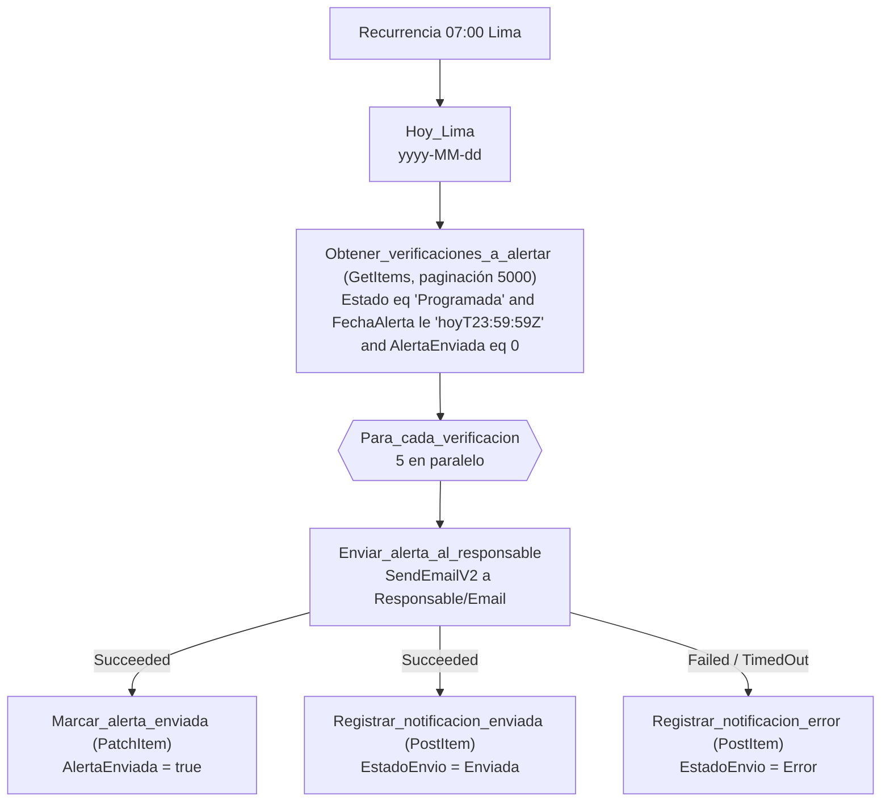

# F1 · Alerta anticipada

**Propósito.** Avisar al **responsable** de cada verificación programada cuando llega su fecha de alerta (RN-01: `FechaAlerta = FechaObjetivo − DiasAnticipacion`, la escribe la app). La aprobadora **nunca** recibe este aviso (RN-06). Cada envío queda registrado en `VU_Notificaciones`.

| | |
|---|---|
| Nombre sugerido | `VU · F1 Alerta anticipada` |
| Disparador | Recurrencia diaria a las 07:00, zona `SA Pacific Standard Time` (Lima) |
| Listas | lee y actualiza `VU_Verificaciones`; crea en `VU_Notificaciones` |
| Conexiones | `vu_sharepoint`, `vu_office365` |
| Variables de entorno | `vu_SiteUrl`, `vu_ListaVerificaciones`, `vu_ListaNotificaciones` |

## Pasos

## Expresiones clave

| Uso | Expresión |
|---|---|
| Hoy en Lima | `formatDateTime(convertTimeZone(utcNow(), 'UTC', 'SA Pacific Standard Time'), 'yyyy-MM-dd')` |
| Filtro OData (columnas indexadas `Estado`, `FechaAlerta`) | `Estado eq 'Programada' and FechaAlerta le '@{outputs('Hoy_Lima')}T23:59:59Z' and AlertaEnviada eq 0` |
| Fecha objetivo en el correo | `formatDateTime(take(string(items('Para_cada_verificacion')?['FechaObjetivo']), 10), 'dd/MM/yyyy')` |
| Destinatario | `items('Para_cada_verificacion')?['Responsable/Email']` |

Registro en `VU_Notificaciones`: `TipoNotificacion = Alerta anticipada`, `Canal = Correo`, `Destinatario = Responsable`, `FechaEnvio = utcNow()`, `Verificacion/Id = ID`, `Title` = asunto del correo.

## Supuestos y decisiones

- **Filtro de fecha `le 'hoyT23:59:59Z'`** en lugar de `le 'hoy'`. SharePoint guarda una fecha "solo fecha" como medianoche de la zona del sitio convertida a UTC (en Lima, `05:00Z`). Con `le '2026-10-13'` (= `00:00Z`) la alerta del mismo día no saldría hasta el día siguiente. El margen hasta las 23:59:59Z funciona para un sitio en UTC−5. Si el sitio usa otra zona, conviene revisarlo.
- **Reintento natural.** Si el correo falla, `AlertaEnviada` no cambia y la alerta se reintenta al día siguiente. Cada intento fallido deja una fila `Error`, y la ejecución termina en estado *Failed* para que se vea en el historial.
- **`PatchItem` reenvía las columnas obligatorias** de `VU_Verificaciones` (Title, Solucion, Responsable, FechaObjetivo, DiasAnticipacion, FechaAlerta, AlertaEnviada, EntrevistasPrevistas, EntrevistasCompletas, Modalidad, Estado, NotificarAlFinalizar) con el valor leído en el mismo `GetItems`. El esquema dinámico de *Update item* exige las columnas *Req.* (ver el README general).
- La edición la hace la cuenta de servicio, así que F2 y F3 no se disparan (por la condición del desencadenador).
- Si el correo sale pero falla `Marcar_alerta_enviada`, la alerta podría enviarse otra vez al día siguiente. Se acepta el riesgo y la ejecución queda marcada como fallida.
