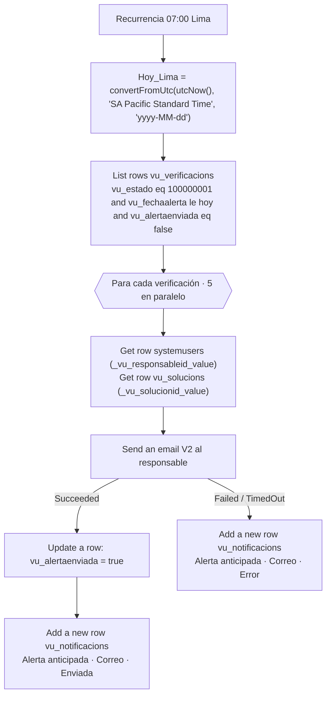

# F1 · Alerta anticipada

**Propósito.** Cada mañana avisa al **responsable** de las verificaciones programadas cuya fecha de alerta (RN-01: `vu_fechaalerta = vu_fechaobjetivo − vu_diasanticipacion`, la escribe la app) ya llegó. Solo escribe al responsable: la aprobadora no recibe nada hasta el envío a revisión (RN-06).

| | |
|---|---|
| Nombre sugerido | `VU · F1 Alerta anticipada` |
| Disparador | Recurrencia diaria a las 07:00, zona `SA Pacific Standard Time` (Lima) |
| Tablas | `vu_verificacion` (lectura y escritura de `vu_alertaenviada`), `vu_solucion` (lectura), `systemuser` (lectura), `vu_notificacion` (alta) |
| Conexiones | `vu_dataverse`, `vu_office365` |
| Variables de entorno | Ninguna |

## Pasos

- `vu_fechaalerta` es *solo fecha*: el filtro la compara con la fecha de hoy en Lima en formato `yyyy-MM-dd`, sin comillas ni hora.
- Si el correo falla, `vu_alertaenviada` sigue en `false`, así que la alerta se reintenta al día siguiente. Cada intento queda en `vu_notificacion` con `vu_estadoenvio = Error (100000001)`.
- El correo va a `internalemailaddress` del usuario y, si está vacío, a `domainname` (UPN).
- Cambiar `vu_alertaenviada` no dispara F2 ni F3, porque ambos filtran por la columna `vu_estado`.

## Valores de opción usados

| Columna | Valor |
|---|---|
| `vu_verificacion.vu_estado` | Programada `100000001` |
| `vu_notificacion.vu_tiponotificacion` | Alerta anticipada `100000000` |
| `vu_notificacion.vu_canal` | Correo `100000000` |
| `vu_notificacion.vu_estadoenvio` | Enviada `100000000` / Error `100000001` |
