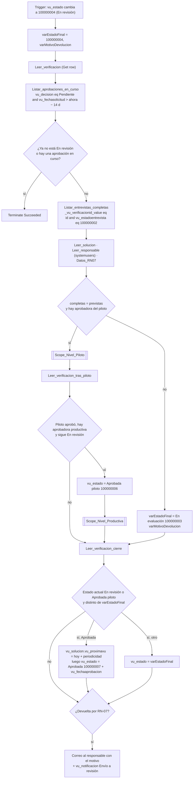

# F2 · Envío a revisión y aprobación en dos niveles

**Propósito.** Cuando la app pone una verificación en `vu_estado = En revisión` ("Finalizar y enviar"), el flujo:

1. Revalida RN-07 en el servidor (entrevistas completas = previstas) y que haya aprobadora del piloto.
2. Pide la aprobación del **piloto** y después la **productiva** (RN-08) con Approvals (respuestas personalizadas *Aprobar / Observar / Rechazar*).
3. Registra cada nivel en `vu_aprobacion`.
4. Avisa al responsable por correo y Teams, y deja constancia en `vu_notificacion` (`Enviada` o `Error`).
5. Escribe los estados posteriores a *En revisión* (§2.4: solo los escribe este flujo).
6. Al aprobar, escribe `vu_fechaaprobacion` y recalcula `vu_solucion.vu_proximavu = hoy + vu_periodicidadmeses` (RN-10).

Ya **no** actualiza `vu_solucion.vu_estadovu`: lo hace F3, que se dispara con cada cambio de `vu_estado` que escribe F2 (§3.3).

| | |
|---|---|
| Nombre sugerido | `VU · F2 Envío a revisión` |
| Disparador | Dataverse *When a row is added, modified or deleted* (`SubscribeWebhookTrigger`): `message = 3` (Modified), `entityname = vu_verificacion`, `scope = 4` (Organization), `filteringattributes = vu_estado`, `filterexpression = vu_estado eq 100000004`, `runas = 3` (propietario del flujo). **Concurrencia 25** |
| Tablas | `vu_verificacion` (L/E), `vu_entrevista` (**solo lectura**), `vu_solucion` (L/E `vu_proximavu`), `vu_aprobacion` (C/E), `vu_notificacion` (C), `systemuser` (L) |
| Conexiones | `vu_dataverse`, `vu_approvals`, `vu_office365`, `vu_teams` |
| Variables de entorno | Ninguna |

## Pasos

Cada **Scope_Nivel_<N>** hace:

1. `Add a new row` en `vu_aprobacions`: `vu_name = "<código> · <nivel>"`, `vu_VerificacionId@odata.bind`, `vu_nivel`, `vu_AprobadorId@odata.bind`, `vu_decision = Pendiente`, `vu_fechasolicitud`.
2. *Start and wait for an approval* (`Custom`, `Aprobar/Observar/Rechazar`, `limit.timeout = P14D`).
3. `vu_notificacion` *Envío a revisión* hacia la aprobadora (`Error` si la solicitud falló). Si la solicitud falló, la ejecución termina en `Failed` y la verificación se queda como estaba.
4. `Update a row` en `vu_aprobacions`: `vu_decision`, `vu_comentario`, `vu_fechadecision`, `vu_approvalid`.
5. Fija `varEstadoFinal`, avisa al responsable por correo y Teams y registra ambos avisos (`runAfter` Succeeded/Failed/TimedOut con `vu_estadoenvio` calculado, para que un fallo de aviso no detenga la aprobación).

| Respuesta | `vu_decision` | Estado tras **Piloto** | Estado tras **Productiva** |
|---|---|---|---|
| Aprobar | Aprobada `100000001` | Aprobada piloto `100000006` | Aprobada `100000007` |
| Observar | Observada `100000002` | Observada `100000005` | Observada `100000005` |
| Rechazar | Rechazada `100000003` | Observada `100000005` | Observada `100000005` |
| Sin respuesta en 14 días | Pendiente `100000000` + comentario de expiración | Observada `100000005` | Aprobada piloto `100000006` |

## Concurrencia 25

El disparador lleva `runtimeConfiguration.concurrency.runs = 25` (no 1). Cada ejecución puede esperar hasta 28 días (dos niveles de 14 días); con concurrencia 1 todas las demás verificaciones se quedarían en cola detrás de la primera. Las ejecuciones en paralelo son seguras porque:

- Cada ejecución trabaja sobre una sola verificación (la del disparador).
- Al empezar vuelve a leer `vu_estado` y termina si ya no está *En revisión*.
- **Guarda de idempotencia**: termina si la verificación ya tiene una `vu_aprobacion` *Pendiente* solicitada hace menos de 14 días. Hace falta porque el disparador de Dataverse se activa cuando `vu_estado` viene en la actualización aunque no cambie su valor (por ejemplo, si la app guarda otra vez la fila con `vu_estado = En revisión`).
- Antes de cada escritura de estado vuelve a leer la fila y solo escribe si sigue en *En revisión* o *Aprobada piloto* (no pisa una cancelación hecha mientras tanto).

Queda una ventana de segundos: dos actualizaciones casi simultáneas podrían arrancar dos ejecuciones antes de que ninguna haya creado su `vu_aprobacion`. La app solo escribe *En revisión* una vez, al finalizar, así que el riesgo es bajo.

## Notas

- `vu_fechaenvio` de la verificación la escribe la app al finalizar (§2.3). F2 ya no la escribe.
- Las búsquedas se leen con `_vu_<col>_value` y se escriben con `<SchemaName>@odata.bind` (`vu_VerificacionId`, `vu_AprobadorId`, `vu_DestinatarioId`), según `infra/dataverse/schema.json`.
- Los correos de aprobadores y responsable salen de `systemuser.internalemailaddress` y, si está vacío, de `domainname` (UPN).
- La próxima VU se escribe **antes** de poner `Aprobada`, para que F3 (que se dispara con ese cambio) ya vea la fecha nueva y calcule *Vigente*.
- Para probar los plazos sin esperar, cambia temporalmente `limit.timeout` a `PT5M` en desarrollo.
