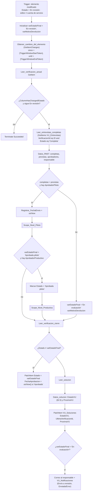
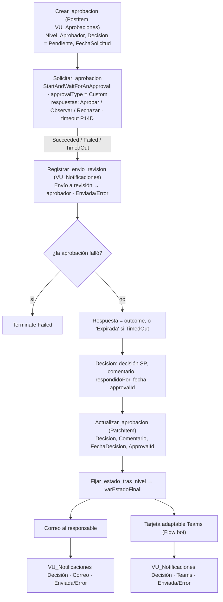

# F2 · Envío a revisión y aprobación en dos niveles

**Propósito.** Cuando la app pone una verificación en `Estado = En revisión` ("Finalizar y enviar"), el flujo:

1. Revalida RN-07 en el servidor.
2. Pide la aprobación del **piloto** y después la **productiva** (RN-08), con Approvals.
3. Registra cada decisión en `VU_Aprobaciones`.
4. Avisa al responsable y deja constancia en `VU_Notificaciones`.
5. Escribe los estados posteriores a *En revisión*, que solo puede escribir este flujo (§2.4).
6. Al aprobar, recalcula `ProximaVU` de la solución (RN-10).

| | |
|---|---|
| Nombre sugerido | `VU · F2 Envío a revisión` |
| Disparador | SharePoint **When an item or a file is modified** (`GetOnChangedItems`) en `VU_Verificaciones`, sondeo cada 5 min, `splitOn` por elemento, **concurrency control = 1** |
| Condiciones del desencadenador | `@equals(triggerOutputs()?['body/Estado/Value'], 'En revisión')` y que el editor no sea la cuenta de servicio: `@not(equals(toLower(coalesce(triggerOutputs()?['body/Editor/Email'], '')), toLower(parameters('vu_CuentaServicioEmail (vu_CuentaServicioEmail)'))))` |
| Listas | `VU_Verificaciones` (L/E), `VU_Entrevistas` (**solo lectura**), `VU_Aprobaciones` (C/E), `VU_Notificaciones` (C), `VU_Soluciones` (E) |
| Conexiones | `vu_sharepoint`, `vu_approvals`, `vu_office365`, `vu_teams` |
| Variables de entorno | `vu_SiteUrl`, `vu_ListaVerificaciones`, `vu_ListaSoluciones`, `vu_ListaEntrevistas`, `vu_ListaAprobaciones`, `vu_ListaNotificaciones`, `vu_CuentaServicioEmail` |

## Pasos

Cada **Scope_Nivel_<Piloto|Productiva>** sigue estos pasos:

## Mapeo de decisiones

| Nivel | Respuesta en Approvals | `VU_Aprobaciones.Decision` | `varEstadoFinal` → `VU_Verificaciones.Estado` | `VU_Soluciones.EstadoVU` |
|---|---|---|---|---|
| Piloto | Aprobar | Aprobada | `Aprobada piloto` → pasa al nivel productivo | En revisión |
| Piloto | Observar | Observada | `Observada` | En proceso |
| Piloto | Rechazar | **Rechazada** | `Observada` (hueco del diseño, ver abajo) | En proceso |
| Piloto | sin respuesta en 14 días | Pendiente + comentario "expiró" | `Observada` (permite reenviar) | En proceso |
| Productiva | Aprobar | Aprobada | `Aprobada` + `FechaAprobacion = utcNow()` | **Vigente** + `ProximaVU` |
| Productiva | Observar / Rechazar | Observada / Rechazada | `Observada` | En proceso |
| Productiva | sin respuesta en 14 días | Pendiente + comentario "expiró" | se queda en `Aprobada piloto` | En revisión |
| (sin AprobadorProductivo) | — | — | se queda en `Aprobada piloto` | En revisión |
| RN-07 no se cumple | — (no se crea la aprobación) | — | `En evaluación` + aviso al responsable | En proceso |

## Expresiones clave

| Uso | Expresión |
|---|---|
| ¿Cambió `Estado` en esta ventana? | `body('Obtener_cambios_del_elemento')?['ColumnHasChanged']?['Estado']` |
| Entrevistas completas (RN-07) | `length(body('Leer_entrevistas_completas')?['value'])` |
| Previstas (tolera `4` o `4.0`) | `int(first(split(string(coalesce(body('Leer_verificacion_actual')?['EntrevistasPrevistas'], 0)), '.')))` |
| Respuesta de la aprobación | `if(equals(actions('Solicitar_aprobacion_Piloto')?['status'], 'Succeeded'), coalesce(actions('Solicitar_aprobacion_Piloto')?['outputs']?['body']?['outcome'], 'Expirada'), 'Expirada')` |
| Comentario del aprobador | `actions('Solicitar_aprobacion_Piloto')?['outputs']?['body']?['responses']?[0]?['comments']` |
| EstadoVU (§2.5) | `if(equals(varEstadoFinal,'Aprobada'),'Vigente', if(or(equals(varEstadoFinal,'Aprobada piloto'), equals(varEstadoFinal,'En revisión')),'En revisión','En proceso'))` |
| Próxima VU (RN-10) | `addToTime(convertTimeZone(utcNow(),'UTC','SA Pacific Standard Time'), int(first(split(string(coalesce(PeriodicidadMeses, 6)), '.'))), 'Month', 'yyyy-MM-dd')` |
| Estado del envío en la bitácora | `if(equals(actions('Avisar_decision_correo_Piloto')?['status'], 'Succeeded'), 'Enviada', 'Error')` |

## Supuestos, decisiones y límites

- **Disparador `When an item or a file is modified` en lugar de `When an item is created or modified`.** Los tokens `{TriggerWindowStartToken}` y `{TriggerWindowEndToken}`, que pide *Get changes for an item* (`since`/`until`), solo los devuelve ese disparador, según la documentación del conector. No se pierde nada, porque *En revisión* siempre se alcanza editando y nunca creando (la verificación nace en *Borrador* o *Programada*). Requiere el **historial de versiones** activo en `VU_Verificaciones` (ya está previsto en §2.1).
- **Concurrency control = 1 (lo pide el diseño). ⚠️ Riesgo importante:** la ejecución espera la aprobación hasta 14 + 14 días, y mientras tanto las demás verificaciones que se envíen a revisión **quedan en cola**. Power Automate admite como máximo `10 + 1` ejecuciones en espera; con la cola llena, el disparador deja de sondear. Para volúmenes reales (varias revisiones al mes) se recomienda subir `runtimeConfiguration.concurrency.runs` (por ejemplo a 25). Es seguro hacerlo: cada ejecución trabaja sobre una sola verificación, y F2 vuelve a leer el elemento y descarta los cambios que no son de `Estado` o que ya no están *En revisión*. El control de concurrencia no se puede desactivar una vez activado, pero sí cambiar su valor. Con la concurrencia activada, `splitOn` admite como máximo 100 elementos por sondeo.
- **Límite de 30 días por ejecución.** Una ejecución de Power Automate dura como máximo 30 días. Cada nivel tiene `limit.timeout = P14D`, así que dos niveles caben en 28 días. Si vence el plazo, la aprobación se cancela (*TimedOut*), `Decision` se queda en `Pendiente` con un comentario que indica que expiró, y el estado avanza según la tabla de arriba. Approvals cancela la solicitud al cancelarse la acción.
- **Fallo técnico de Approvals** (no se crea la solicitud): se registra la notificación con `Error` y la ejecución termina en *Failed*. La verificación se queda en *En revisión*, o en *Aprobada piloto* si falló el nivel productivo. El administrador corrige la causa y **reenvía la ejecución**.
- **Avisos al responsable que no bloquean el proceso.** Cada envío (correo o Teams) va seguido de un `PostItem` con `runAfter` *Succeeded / Failed / TimedOut* que calcula `EstadoEnvio` (`Enviada` o `Error`). Así, un fallo de correo no detiene la aprobación.
- **Reasignación desactivada** (`enableReassignment = false`), para que quien responde coincida con `VU_Aprobaciones.Aprobador`.
- **`FechaEnvio`** de la verificación la escribe F2 (con `utcNow()`) cuando la validación RN-07 se supera, es decir, en el momento real de envío a aprobación.
- **Mantenimiento de `EstadoVU`.** F2 escribe con la cuenta de servicio y F3 excluye esas ediciones para evitar bucles, así que **F2 actualiza `EstadoVU` y `UltimaVerificacionId` de la solución** al cerrar (acciones `Leer_solucion`, `Datos_solucion` y `Actualizar_solucion`). Cuando el usuario pone *En revisión*, F3 ya ha dejado `EstadoVU = En revisión`. Durante la espera productiva ese valor no cambia, porque *Aprobada piloto* también se traduce en *En revisión*.
- Todos los `PatchItem` reenvían las columnas obligatorias de la lista leídas **justo antes** con `GetItem` (`Leer_verificacion_actual`, `Leer_verificacion_tras_piloto`, `Leer_verificacion_cierre`, `Leer_solucion`), porque tras una espera de días los datos del disparador estarían desactualizados.
- `NotificarAlFinalizar` **no se usa**: las solicitudes de aprobación siempre se notifican (ver los huecos del diseño en el README general).
- RN-06: F2 **lee** `VU_Entrevistas`, pero no hay ningún flujo que se dispare desde esa lista.
