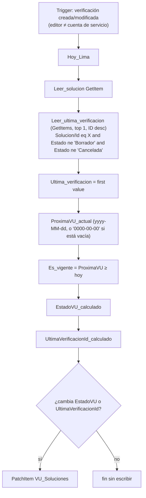

# F3 · Estado de la solución (EstadoVU)

**Propósito.** Mantener al día `VU_Soluciones.EstadoVU` y `UltimaVerificacionId` (§2.5) cada vez que un **usuario** crea o modifica una verificación desde la app (Borrador, Programada, En levantamiento, En evaluación, En revisión, Cancelada…).

| | |
|---|---|
| Nombre sugerido | `VU · F3 Estado de la solución` |
| Disparador | SharePoint **When an item is created or modified** (`GetOnUpdatedItems`) en `VU_Verificaciones`, sondeo cada 5 min, `splitOn`, concurrency control = 1 |
| Condiciones del desencadenador | editor ≠ cuenta de servicio: `@not(equals(toLower(coalesce(triggerOutputs()?['body/Editor/Email'], '')), toLower(parameters('vu_CuentaServicioEmail (vu_CuentaServicioEmail)'))))`<br/>y la verificación tiene solución: `@not(empty(string(coalesce(triggerOutputs()?['body/Solucion/Id'], ''))))` |
| Listas | lee `VU_Verificaciones`; lee y actualiza `VU_Soluciones` |
| Conexiones | `vu_sharepoint` |
| Variables de entorno | `vu_SiteUrl`, `vu_ListaVerificaciones`, `vu_ListaSoluciones`, `vu_CuentaServicioEmail` |

## Pasos



## Regla de cálculo (§2.5)

"Última verificación" significa la verificación más reciente (ID mayor) de la solución que **no** está en *Borrador* ni *Cancelada*. Se lee de nuevo en el servidor, no se toma del disparador.

| Situación | EstadoVU |
|---|---|
| No hay última verificación | `Vigente` si `ProximaVU ≥ hoy`; si no, `Pendiente` (borradores y canceladas recalculan a *Pendiente*, salvo que la solución siga vigente) |
| Programada | `Programada` |
| En levantamiento / En evaluación / Observada | `En proceso` |
| En revisión / Aprobada piloto | `En revisión` |
| Aprobada | `Vigente` si `ProximaVU ≥ hoy`; si no, `Pendiente` |

```text
if(empty(Ultima), if(Es_vigente,'Vigente','Pendiente'),
 if(equals(Estado,'Programada'),'Programada',
  if(contains(createArray('En levantamiento','En evaluación','Observada'), Estado),'En proceso',
   if(contains(createArray('En revisión','Aprobada piloto'), Estado),'En revisión',
    if(Es_vigente,'Vigente','Pendiente')))))
```

Comparación de fechas sin problemas de formato: `int(replace('2027-04-13','-',''))`, que da `20270413`, frente al mismo cálculo con *hoy* en Lima.

## Supuestos y decisiones

- **Antibucle.** F3 solo escribe en `VU_Soluciones`, nunca en `VU_Verificaciones`, y además descarta las ediciones de la cuenta de servicio. Por eso **no ve los cambios de F1 ni de F2**. F2 actualiza `EstadoVU` por su cuenta al cerrar, y F4 marca `Pendiente` al vencer.
- **Carrera F2/F3.** Cuando el usuario pone *En revisión*, F2 y F3 se disparan a la vez. F3 vuelve a leer la última verificación, así que si F2 ya la devolvió a *En evaluación* calcula *En proceso*. Queda una ventana de segundos en la que F3 podría escribir *En revisión* después de F2. Se acepta y se corrige en el siguiente cambio.
- Si `ProximaVU` está en blanco, se trata como "no vigente".
- La escritura se omite cuando no hay cambios, para no generar versiones inútiles en `VU_Soluciones`.
- `PatchItem` reenvía las columnas obligatorias de `VU_Soluciones` (Title, Proceso, Responsable, PeriodicidadMeses, EstadoVU) leídas en `Leer_solucion`.
- Borrar una verificación no dispara F3 (no hay disparador de eliminación). La solución se recalcula en la siguiente edición o en el siguiente F4.
