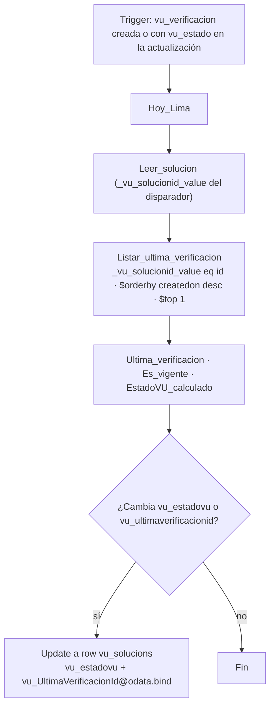

# F3 · Estado de la solución

**Propósito.** Mantener `vu_solucion.vu_estadovu` y `vu_solucion.vu_ultimaverificacionid` según §2.5 cada vez que se crea una verificación o cambia su `vu_estado`, tanto si lo cambia la app como si lo cambia F2.

| | |
|---|---|
| Nombre sugerido | `VU · F3 Estado de la solución` |
| Disparador | Dataverse *When a row is added, modified or deleted* (`SubscribeWebhookTrigger`): `message = 4` (Added or Modified), `entityname = vu_verificacion`, `scope = 4` (Organization), `filteringattributes = vu_estado`, sin filtro de filas, `runas = 3`. **Concurrencia 1** |
| Tablas | `vu_verificacion` (lectura), `vu_solucion` (L/E) |
| Conexiones | `vu_dataverse` |
| Variables de entorno | Ninguna |

## Pasos

## Regla (§2.5)

| `vu_estado` de la última verificación | `vu_estadovu` |
|---|---|
| No hay, Borrador `100000000` o Cancelada `100000008` | Pendiente `100000000` |
| Programada `100000001` | Programada `100000001` |
| En levantamiento `100000002`, En evaluación `100000003`, Observada `100000005` | En proceso `100000002` |
| En revisión `100000004`, Aprobada piloto `100000006` | En revisión `100000003` |
| Aprobada `100000007` y `vu_proximavu ≥ hoy` | Vigente `100000004` |
| Aprobada `100000007` y `vu_proximavu` vacía o `< hoy` | Pendiente `100000000` |

- "Hoy" es la fecha de Lima (`yyyy-MM-dd`) y `vu_proximavu` es solo fecha, así que se comparan como enteros `yyyyMMdd`.
- La "última verificación" es la creada más recientemente de la solución (`createdon desc`).
- Sin riesgo de bucle: F3 solo escribe en `vu_solucion` y su disparador escucha `vu_verificacion.vu_estado`.
- Concurrencia 1: serializa los recálculos para que dos cambios casi simultáneos (por ejemplo, la app y F2) no se pisen. Cada ejecución lee el estado actual, así que la última siempre deja el valor correcto.
- El paso de una solución *Vigente* a *Pendiente* cuando vence la fecha sin que cambie ninguna verificación lo hace F4.
