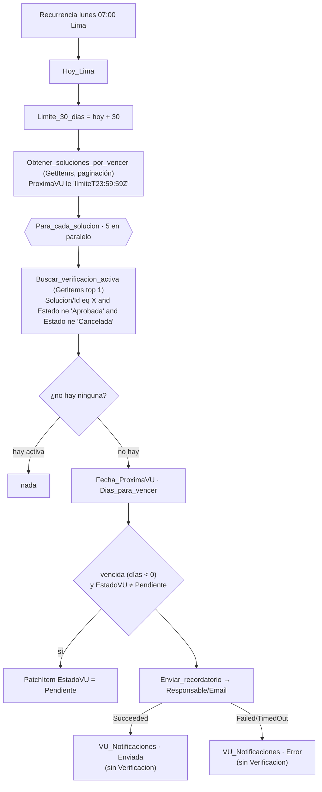

# F4 · Vencimiento de la VU

**Propósito.** Cada lunes, recordar al **responsable de la solución** que su verificación de uso vence en los próximos 30 días (o que ya venció) cuando la solución no tiene ninguna verificación activa. Además marca `EstadoVU = Pendiente` en las soluciones vencidas.

| | |
|---|---|
| Nombre sugerido | `VU · F4 Vencimiento` |
| Disparador | Recurrencia semanal, **lunes 07:00**, zona `SA Pacific Standard Time` |
| Listas | lee y actualiza `VU_Soluciones`; lee `VU_Verificaciones`; crea en `VU_Notificaciones` |
| Conexiones | `vu_sharepoint`, `vu_office365` |
| Variables de entorno | `vu_SiteUrl`, `vu_ListaVerificaciones`, `vu_ListaSoluciones`, `vu_ListaNotificaciones` |

## Pasos

## Expresiones clave

| Uso | Expresión |
|---|---|
| Límite | `formatDateTime(addDays(convertTimeZone(utcNow(),'UTC','SA Pacific Standard Time'), 30), 'yyyy-MM-dd')` |
| Filtro (columna indexada `ProximaVU`) | `ProximaVU le '@{outputs('Limite_30_dias')}T23:59:59Z'` |
| Verificación activa (indexadas `Solucion`, `Estado`) | `Solucion/Id eq @{items('Para_cada_solucion')?['ID']} and Estado ne 'Aprobada' and Estado ne 'Cancelada'` |
| Días para vencer | `div(sub(ticks(concat(Fecha_ProximaVU,'T00:00:00Z')), ticks(concat(Hoy_Lima,'T00:00:00Z'))), 864000000000)` |

## Supuestos y decisiones

- "Verificación activa" es cualquier verificación de la solución que no esté en *Aprobada* ni en *Cancelada*, **incluidas las que están en *Borrador***: un borrador ya cuenta como gestión iniciada.
- Los recordatorios se repiten **cada lunes** mientras no exista una verificación activa: desde 30 días antes hasta después del vencimiento. No se deduplican.
- **Registro en la bitácora sin `Verificacion`** (decisión de coordinación). El recordatorio pertenece a la solución y no hay ninguna verificación activa, así que la fila de `VU_Notificaciones` se crea **con `Verificacion` vacía**; no se inventa un ID. Requiere que `VU_Notificaciones.Verificacion` pase a ser opcional en el esquema, cambio que hará coordinación en la integración. Mientras siga siendo obligatoria, el registro fallará.
- Las soluciones con `ProximaVU` en blanco no entran en el filtro: nunca se verificaron y no tienen fecha de vencimiento.
- Con `ProximaVU < hoy` y sin verificación activa, `EstadoVU` pasa a `Pendiente`, coherente con F3. Si hay una verificación activa, F4 no toca `EstadoVU`, porque F3 ya refleja el estado de esa verificación.
- `PatchItem` reenvía las columnas obligatorias de `VU_Soluciones` con los valores leídos en `Obtener_soluciones_por_vencer`.
- Si el correo falla, la ejecución queda marcada como *Failed* (para que se vea) y se registra `EstadoEnvio = Error`.
