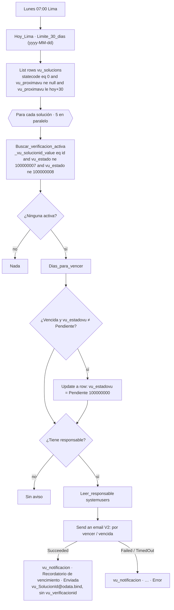

# F4 · Vencimiento

**Propósito.** Cada semana recuerda al responsable de cada solución que su verificación de uso vence en los próximos 30 días, o que ya venció, cuando la solución no tiene ninguna verificación activa. Si ya venció, además pone `vu_estadovu = Pendiente` (§2.5).

| | |
|---|---|
| Nombre sugerido | `VU · F4 Vencimiento` |
| Disparador | Recurrencia semanal, lunes a las 07:00, zona `SA Pacific Standard Time` (Lima) |
| Tablas | `vu_solucion` (L/E `vu_estadovu`), `vu_verificacion` (lectura), `systemuser` (lectura), `vu_notificacion` (alta) |
| Conexiones | `vu_dataverse`, `vu_office365` |
| Variables de entorno | Ninguna |

## Pasos

- "Activa" = cualquier verificación que no esté *Aprobada* ni *Cancelada* (incluye *Borrador*: si ya hay un borrador, no se insiste).
- La fila de `vu_notificacion` lleva `vu_solucionid` y deja `vu_verificacionid` vacía (§2.3: opcional).
- Solo se recuerdan las soluciones activas (`statecode eq 0`) que tienen `vu_proximavu`. Las que nunca se han verificado (sin fecha) no se recuerdan.
- El recordatorio se repite cada lunes mientras siga sin haber una verificación activa.
- Las soluciones sin responsable (el catálogo importado llega así) se marcan *Pendiente* igual, pero no generan correo ni fila en `vu_notificacion`: no hay destinatario (`vu_destinatarioid` apunta a `systemuser`).
